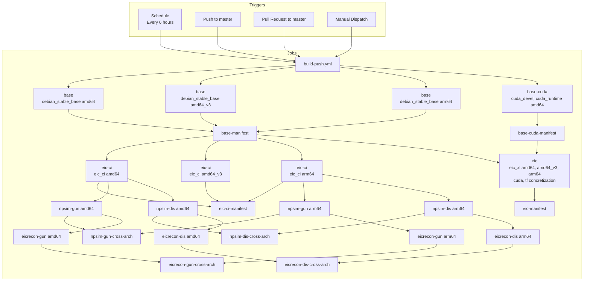
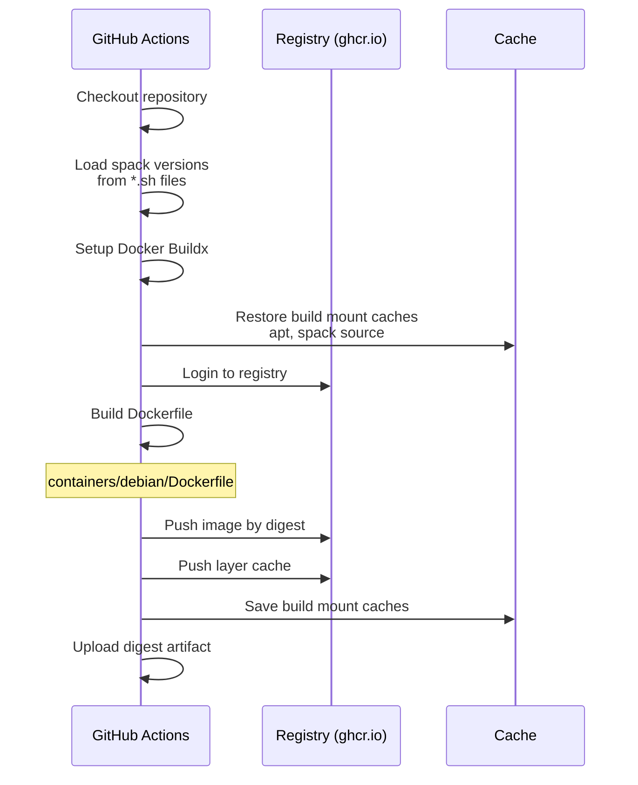
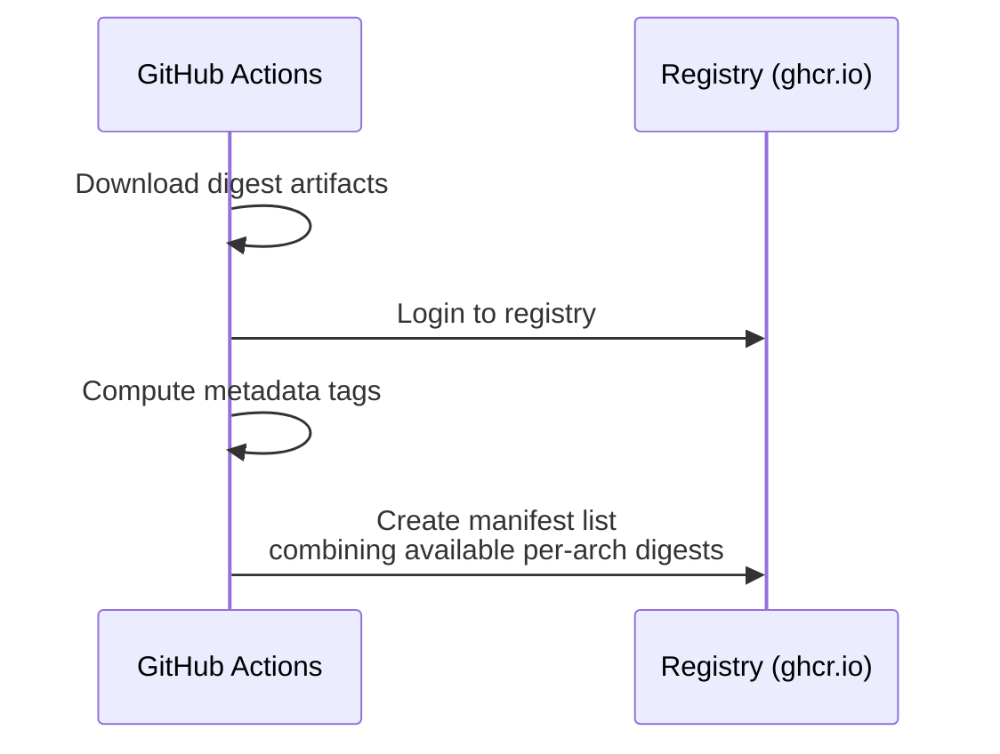
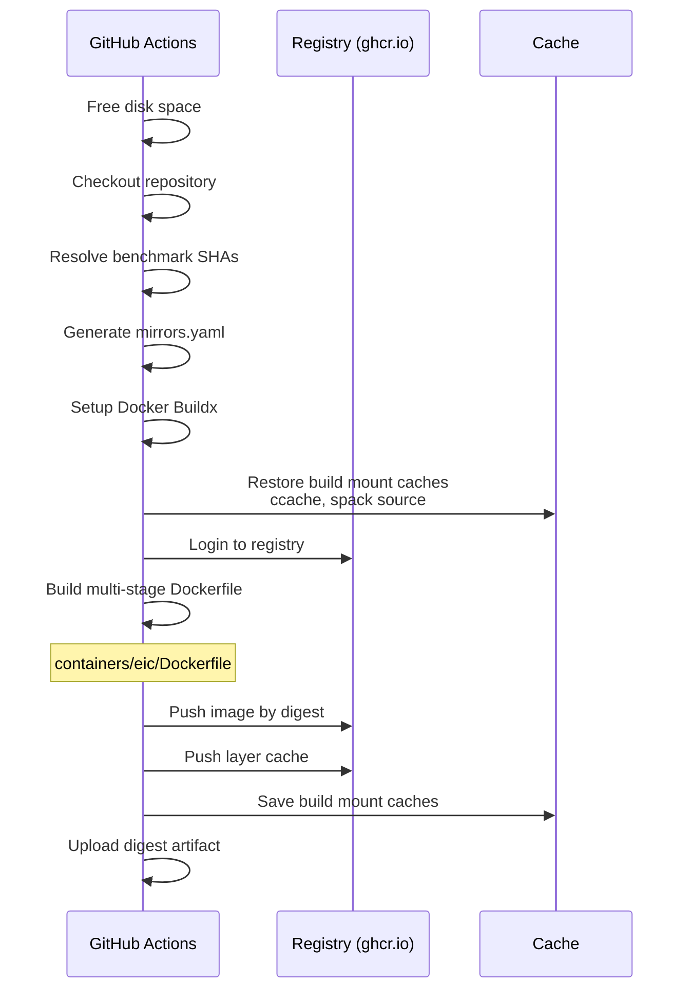

# Build Pipeline

The container build pipeline is implemented as a GitHub Actions workflow. This document describes the workflow structure and job dependencies.

`build-push.yml` orchestrates the pipeline but does not itself contain the build steps. Each image is built by one of two **reusable workflows**, which `build-push.yml` calls with a JSON matrix describing the images and architectures to produce:

| Reusable workflow | Builds | Called as |
|---|---|---|
| `build-base.yml` | `debian_stable_base`; `cuda_devel`, `cuda_runtime` | `base`; `base-cuda` |
| `build-eic.yml` | `eic_ci`; `eic_xl` (and the concretization-only `cuda`, `tf` targets) | `eic-ci`; `eic` |

Both take `matrix`, `jobs` and (for the base images) `buildweek` inputs, and both delegate the actual build to `scripts/build-base.sh` / `scripts/build-eic.sh`, which are shared with GitLab CI.

## Workflow Overview



**Note**: Smoke test jobs (npsim, eicrecon) start after the `eic-ci` CI image build completes, without waiting for the multi-architecture manifest. This parallelizes the pipeline and provides faster feedback on simulation regressions.

## Job Details

### Base Image Job

Builds the `debian_stable_base` image with Spack and compilers installed.



**Key Build Arguments:**
- `SPACK_ORGREPO`, `SPACK_VERSION`, `SPACK_SHA`, `SPACK_CHERRYPICKS`
- `SPACKPACKAGES_ORGREPO`, `SPACKPACKAGES_VERSION`, `SPACKPACKAGES_SHA`, `SPACKPACKAGES_CHERRYPICKS`
- `KEY4HEPSPACK_ORGREPO`, `KEY4HEPSPACK_VERSION`, `KEY4HEPSPACK_SHA`
- `EICSPACK_ORGREPO`, `EICSPACK_VERSION`, `EICSPACK_SHA`

### Base Manifest Jobs

`base-manifest` (for `debian_stable_base`) and `base-cuda-manifest` (for `cuda_devel`, `cuda_runtime`) create a multi-architecture manifest from the per-architecture digests. They share their steps through a YAML anchor. `eic-ci` only waits for `base-manifest`.



**Output Tags:**
- `pipeline-{run_id}` - Internal tag for CI chaining
- `unstable-pr-{number}` - For pull requests
- Version tags for releases

### EIC Image Job

Builds the full EIC environment image on top of the base image.



**Key Build Arguments:**
- `ENV` - Environment type (`ci` or `xl`)
- `INTERNAL_TAG` - Base image tag to build from
- Benchmark SHAs for common_bench, detector_benchmarks, etc.

**Secret Mounts:**
- `mirrors.yaml` - Spack buildcache configuration with credentials

### EIC Manifest Jobs

`eic-ci-manifest` (for `eic_ci`) and `eic-manifest` (for `eic_xl`) create multi-architecture manifests for each environment and build type (`default`, `nightly`). They share their steps through a YAML anchor, so the `eic_ci` manifests do not wait for the `eic` builds.

### GitLab CI (eicweb)

`.gitlab-ci.yml` uses the same job names and dependencies, for `linux/amd64` only and with the additional environments built on eicweb:

| Job | Builds or tags | Needs |
|---|---|---|
| `base` | `debian_stable_base` | `version` |
| `base-cuda` | `cuda_devel`, `cuda_runtime` | `version` |
| `base-manifest` | `debian_stable_base` | `base` |
| `base-cuda-manifest` | `cuda_devel`, `cuda_runtime` | `base-cuda` |
| `eic-ci` | `eic_ci` | `base-manifest` |
| `eic` | `eic_xl`, `eic_cvmfs`, `eic_dbg`, `eic_jl`, `eic_prod`, `eic_ci_without_acts`, `eic_cuda`, `eic_tf`, `eic_dev_cuda` | `base-manifest`, `base-cuda-manifest` |
| `eic-ci-manifest` | `eic_ci` | `eic-ci` |
| `eic-manifest` | all images built by `eic` | `eic` |

The benchmarks and `user_spack_environment` need `eic-ci-manifest`; `cuda:torch` and the singularity jobs need `eic-manifest`. For epic/EICrecon trigger pipelines, only `base`, `base-manifest`, `eic-ci` and `eic-ci-manifest` run.

Difference from GitHub Actions: on GitLab, the manifest jobs copy the single-architecture image manifest instead of creating a manifest list.

## Caching Strategy

### Docker Layer Cache

Stored in the registry using the `cache-to` and `cache-from` build options:

```yaml
cache-from: |
  type=registry,ref=ghcr.io/eic/buildcache:{image}-{branch}-{arch}
cache-to: type=registry,ref=ghcr.io/eic/buildcache:{image}-{branch}-{arch},mode=max
```

GitLab CI (eicweb) uses the same scheme with its own registry,
`eicweb.phy.anl.gov:4567/containers/eic_container/buildcache:{image}-{branch}-{arch}`, as both
cache source and destination. It does not import the ghcr.io caches written by GitHub Actions.
Local builds (`scripts/build-*.sh` without CI) import the public ghcr.io caches only.

### Build Mount Cache

Uses [buildkit-cache-dance](https://github.com/reproducible-containers/buildkit-cache-dance) to persist mount caches:

| Cache | Path | Contents |
|-------|------|----------|
| `var-cache-apt` | `/var/cache/apt` | APT package cache |
| `var-lib-apt` | `/var/lib/apt` | APT lists cache |
| `var-cache-spack` | `/var/cache/spack` | Spack source tarballs |
| `ccache` | `/ccache` | Compiler cache |

### Spack Buildcache

Pre-built binaries are stored in OCI registries:

- **Read-only**: `oci://ghcr.io/eic/spack-{version}` - Public buildcache
- **Write**: Configured via secret `mirrors.yaml` mount during builds

## Workflow Triggers

| Trigger | Behavior |
|---------|----------|
| Schedule (cron) | Every 6 hours - nightly builds |
| Push to master | Build and push with `pipeline-*` tag |
| Pull Request | Build with `unstable-pr-*` tag |
| Manual Dispatch | Allows overriding EDM4EIC, EICRECON, JUGGLER versions |

## Environment Matrix

The EIC job builds the following matrix:

| ENV | Architecture | Description |
|-----|--------------|-------------|
| ci | amd64 | CI environment for x86_64 |
| ci | arm64 | CI environment for ARM64 |
| xl | amd64 | Full environment for x86_64 |
| xl | arm64 | Full environment for ARM64 |

## Concurrency Control

```yaml
concurrency:
  group: ${{ github.workflow }}-${{ github.event.pull_request.number || github.ref }}
  cancel-in-progress: false
```

Workflows are grouped by PR number or branch, but **not cancelled** when new commits are pushed (builds are expensive and take hours).
