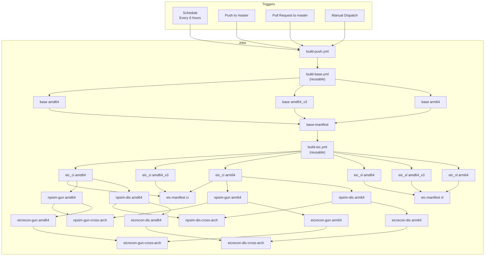
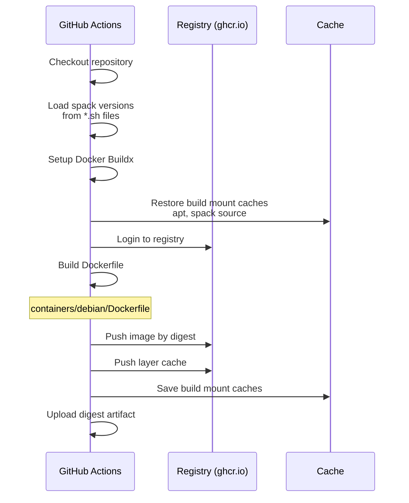
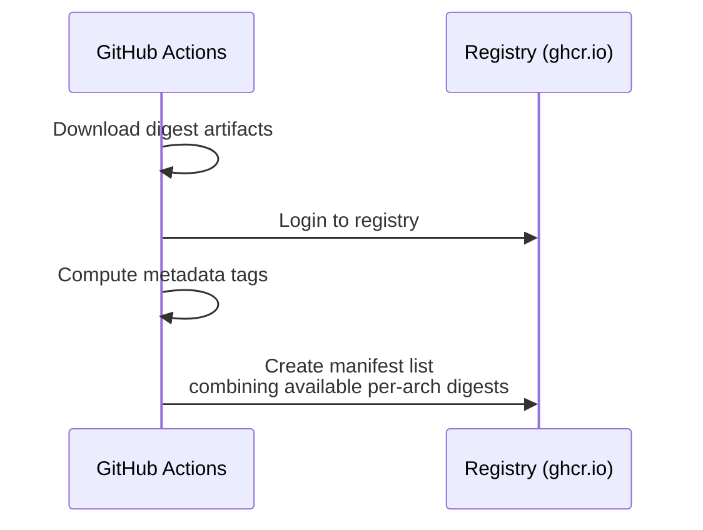
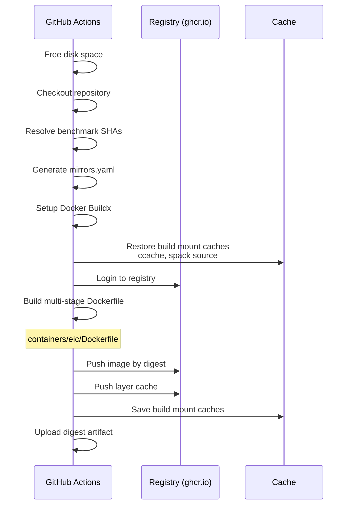

# Build Pipeline

The container build pipeline is implemented as a GitHub Actions workflow. This document describes the workflow structure and job dependencies.

`build-push.yml` orchestrates the pipeline but does not itself contain the build steps. Each image is built by one of two **reusable workflows**, which `build-push.yml` calls with a JSON matrix describing the images and architectures to produce:

| Reusable workflow | Builds | Called as |
|---|---|---|
| `build-base.yml` | `debian_stable_base`, `cuda_devel`, `cuda_runtime` | `base-debian`, `base` |
| `build-eic.yml` | `eic_ci`, `eic_xl` (and the concretization-only `cuda`, `tf` targets) | `eic-ci`, `eic` |

Both take `matrix`, `jobs` and (for the base images) `buildweek` inputs, and both delegate the actual build to `scripts/build-base.sh` / `scripts/build-eic.sh`, which are shared with GitLab CI.

## Workflow Overview



**Note**: Smoke test jobs (npsim, eicrecon) start after the `eic-ci` CI image build completes, without waiting for the multi-architecture manifest. This parallelizes the pipeline and provides faster feedback on simulation regressions.

## Job Details

### Base Image Job

Builds the `debian_stable_base` image with Spack and compilers installed.



**Key Build Arguments:**
- `SPACK_ORGREPO`, `SPACK_VERSION`, `SPACK_SHA`, `SPACK_CHERRYPICKS`
- `SPACKPACKAGES_ORGREPO`, `SPACKPACKAGES_VERSION`, `SPACKPACKAGES_SHA`, `SPACKPACKAGES_CHERRYPICKS`
- `KEY4HEPSPACK_ORGREPO`, `KEY4HEPSPACK_VERSION`, `KEY4HEPSPACK_SHA`
- `EICSPACK_ORGREPO`, `EICSPACK_VERSION`, `EICSPACK_SHA`

### Base Manifest Job

Creates a multi-architecture manifest from the per-architecture digests.



**Output Tags:**
- `pipeline-{run_id}` - Internal tag for CI chaining
- `unstable-pr-{number}` - For pull requests
- Version tags for releases

### EIC Image Job

Builds the full EIC environment image on top of the base image.



**Key Build Arguments:**
- `ENV` - Environment type (`ci` or `xl`)
- `INTERNAL_TAG` - Base image tag to build from
- Benchmark SHAs for common_bench, detector_benchmarks, etc.

**Secret Mounts:**
- `mirrors.yaml` - Spack buildcache configuration with credentials

### EIC Manifest Job

Creates multi-architecture manifests for each environment variant.

## Caching Strategy

### Docker Layer Cache

Stored in the registry using the `cache-to` and `cache-from` build options:

```yaml
cache-from: |
  type=registry,ref=ghcr.io/eic/buildcache:{image}-{branch}-{arch}
cache-to: type=registry,ref=ghcr.io/eic/buildcache:{image}-{branch}-{arch},mode=max
```

### Build Mount Cache

Uses [buildkit-cache-dance](https://github.com/reproducible-containers/buildkit-cache-dance) to persist mount caches:

| Cache | Path | Contents |
|-------|------|----------|
| `var-cache-apt` | `/var/cache/apt` | APT package cache |
| `var-lib-apt` | `/var/lib/apt` | APT lists cache |
| `var-cache-spack` | `/var/cache/spack` | Spack source tarballs |
| `ccache` | `/ccache` | Compiler cache |

### Spack Buildcache

Pre-built binaries are stored in OCI registries:

- **Read-only**: `oci://ghcr.io/eic/spack-{version}` - Public buildcache
- **Write**: Configured via secret `mirrors.yaml` mount during builds

## Reproducibility

The builds follow [reproducible-builds.org](https://reproducible-builds.org/docs/) where this is
cheap, so that identical inputs give identical images as far as possible:

| What | Base images (`containers/debian/Dockerfile`) | EIC images (`containers/eic/Dockerfile`) |
|---|---|---|
| [`SOURCE_DATE_EPOCH`](https://reproducible-builds.org/docs/source-date-epoch/) | Monday 00:00 UTC of the `BUILDWEEK` ISO week | commit time of this repository |
| Image config and history timestamps | `SOURCE_DATE_EPOCH` | `SOURCE_DATE_EPOCH` |
| File timestamps in new layers | clamped to `SOURCE_DATE_EPOCH` (`rewrite-timestamp=true`) | not rewritten |
| Cherry-pick commits in the Spack repositories | fixed author and committer dates, so reproducible hashes | n/a |
| apt/dpkg logs, ldconfig and debconf caches | removed in each apt step | n/a |

Both values can be overridden by setting `SOURCE_DATE_EPOCH` in the environment of
`scripts/build-base.sh` or `scripts/build-eic.sh`.

Notes:
- `BUILDWEEK` is `date +%Gw%V`, the ISO week-numbering year with the ISO week, so the last days
  of December and the first days of January map to the correct week.
- The base Dockerfile declares `ARG SOURCE_DATE_EPOCH` right after `ARG BUILDWEEK`. The value is
  derived from `BUILDWEEK`, so it only changes cache keys when `BUILDWEEK` does.
- The EIC Dockerfile must not declare `ARG SOURCE_DATE_EPOCH`. Undeclared, the build argument only
  sets image metadata: it is not visible to `RUN` steps and does not enter their cache keys, so a
  new commit does not invalidate the layer cache.
- EIC images do not use `rewrite-timestamp`, which BuildKit leaves off by default "due to the
  overhead of rewriting image layers": it re-tars every new layer at export, and the rewritten
  image blobs can no longer be shared with the registry layer cache blobs. Inherited base layers are
  never rewritten.
- Not reproducible yet:
  - Package versions installed by apt. `apt-get` installs what the archive serves at build time,
    so a rebuild later in the same week can get newer packages. The
    [SOURCE_DATE_EPOCH documentation](https://reproducible-builds.org/docs/source-date-epoch/#apt-get)
    suggests pinning the Debian and Ubuntu archives to `snapshot.debian.org` /
    `snapshot.ubuntu.com` at `SOURCE_DATE_EPOCH`, e.g. with
    [repro-sources-list.sh](https://github.com/reproducible-containers/repro-sources-list.sh).
    The third-party repositories (apt.llvm.org, NVIDIA's CUDA repository) have no snapshots.
  - The `.git` directories of the Spack repositories: the index records file metadata of the
    checkout, and the clone contains the default branch history at clone time.
  - Python bytecode written while Spack runs.

## Workflow Triggers

| Trigger | Behavior |
|---------|----------|
| Schedule (cron) | Every 6 hours - nightly builds |
| Push to master | Build and push with `pipeline-*` tag |
| Pull Request | Build with `unstable-pr-*` tag |
| Manual Dispatch | Allows overriding EDM4EIC, EICRECON, JUGGLER versions |

## Environment Matrix

The EIC job builds the following matrix:

| ENV | Architecture | Description |
|-----|--------------|-------------|
| ci | amd64 | CI environment for x86_64 |
| ci | arm64 | CI environment for ARM64 |
| xl | amd64 | Full environment for x86_64 |
| xl | arm64 | Full environment for ARM64 |

## Concurrency Control

```yaml
concurrency:
  group: ${{ github.workflow }}-${{ github.event.pull_request.number || github.ref }}
  cancel-in-progress: false
```

Workflows are grouped by PR number or branch, but **not cancelled** when new commits are pushed (builds are expensive and take hours).
